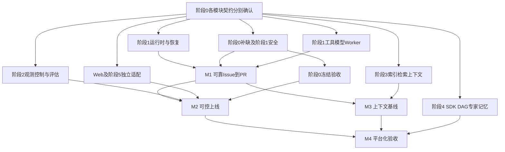

# AI Agent 平台项目开发执行手册

> **文档版本**: v2.0（2026-10-29 依赖驱动与多AI任务领取）
> **创建日期**: 2026-10-06
> **文档状态**: 开发执行指南（基于最新设计文档整合）
> **适用范围**: 开发团队、项目经理、架构师

---

## 📋 文档目的

本文档是 AI Agent 平台项目的**唯一开发执行指南**，用于：

1. **明确当前状态**：项目处于哪个阶段，已完成什么，待做什么
2. **消除方向模糊**：清晰的开发步骤、优先级和验收标准
3. **统一理解基线**：所有团队成员对需求和实现路径的统一认知
4. **指导日常开发**：每个开发任务的具体执行步骤和检查清单

---

## 🎯 项目当前状态（2026-10-29 验收更新）

> **阶段 0 / 步骤 1：✅ 对齐评审已完成（2026-10-28）**；交付后用户回复“继续”，据此记录评审文档验收。**步骤 2 / SEC-007 生命周期发现与调用一致拒绝（含依赖升级与扫描配置）：✅ 已于 2026-10-29 验收完成**；用户指令“将已完成的任务标记✅”作为本次验收依据，**连接器级凭据失效与 SEC-005 撤销联动：✅ 已于 2026-10-29 用户验收完成**，见[验收记录](./docs/delivery-reports/sec007-credential-invalidation-acceptance-2026-10-29.json)；已有会话正在实施**工具批准与 Schema 变更复审（三点方案已确认，台账S0-SCHEMA占用中）**，见[本轮方案](./docs/review/sec007-tool-approval-schema-design-2026-10-29.md)；上项证据见[已验收方案](./docs/review/sec007-lifecycle-discovery-design-2026-10-28.md)及[安全门禁增量报告](./docs/test-reports/sec007-security-gate-2026-10-28.md)。全项目允许任意数量满足依赖的任务并行；每个任务先领取、确认实施基线后编码、交付确认后标记完成。
>
> 本文即用户所称《项目开发步骤》。开发调度以本文“依赖驱动调度与多 AI 领取”及共享台账为准；历史顶部 Task 2.1～2.4 仅作追溯编号。与《迭代开发规则》不一致时：**调度按本文**；质量门禁与证据纪律按[迭代规则](./规则文档/AGENTS.md)及本文 DoD 中更严且已确认的阈值。裁决摘要见[冲突优先级与日常清单](./规则文档/冲突优先级与日常清单.md)；仍冲突则提交用户确认。

### 一、状态与验证口径

- 正式需求 **60 项**：RT 8、SEC 10、REL 9、CTX 9、MEM 4、HAR 6、OBS 7、EVA 7。
- Runtime 八份契约按各专项页保留 **2026-10-07 已冻结**记录：RT-001 为 v0.2-frozen，其余为 v0.1-frozen。冻结不表示代码全项验收通过。
- 其余 52 项未冻结，其中 CTX-008 文件开头不完整；只能确认 60 项文件已定位，不能宣称设计完整率 100%。
- 历史回归（2026-10-28）：**2001 通过、0 失败、3 跳过**；行覆盖率 85.55%；Ruff 全仓 0 诊断、mypy 196 源文件 0 错误。见[修复报告](./docs/test-reports/remaining-issues-2026-10-28.json)。本轮验证另见[对齐评审报告](./docs/test-reports/stage0-alignment-2026-10-28.json)，两次结果不混用。
- 2026-10-29 的 3 个真实 Docker 用例已通过并随凭据失效切片获用户验收；实际 SAST/SCA/Secret 门禁已通过，不能以扫描适配器测试代替真实扫描。API 配置和启动方式见 [API 说明](./docs/api/README.md)。
- 设计状态、代码实现、测试结果、用户验收分别记录。下表是完整阶段状态，单项功能见[逐项需求清单与历史证据](./docs/review/roadmap-status-and-stage0-proposal-2026-10-28.md)。

### 二、阶段能力概览（历史实现状态，不代表实时任务占用）

实时负责人和领取状态请读取共享台账；下表“进行中”仅表示能力已有基础，不能据此认定有人正在领取。

| 正文顺序 | 任务 | 能力状态 | 已有成果与剩余缺口 |
|---|---|---|---|
| 0 / 步骤 1 | 对齐评审与状态基线整理 | ✅ 已完成，2026-10-28 | 60 项需求、341 本地链接通过；全量 2001 通过 / 3 Docker 跳过；完成范围为评审文档 |
| 0 / 步骤 2 | SEC-007 停用后的发现与调用一致拒绝（含依赖升级与扫描配置） | ✅ 已完成，2026-10-29 用户验收 | 2026-10-28 实测：生命周期专项 46、门禁专项 53、全量 2100 通过 / 3 Docker 跳过；SAST/SCA/Secret 通过 |
| 0 / 步骤 2 | SEC-007 连接器级凭据失效与 SEC-005 撤销联动 | ✅ 已完成，2026-10-29 用户验收 | 已按[方案](./docs/review/sec007-credential-invalidation-design-2026-10-29.md)实现；全量 2146 通过 / 0 跳过（含真实 Docker 3），关键方法 100% 行覆盖；[报告](./docs/test-reports/sec007-credential-invalidation-2026-10-29.md) |
| 0 / 步骤 2 | SEC-007 工具批准与 Schema 变更复审 | 进行中：已确认实施 | 已核对需求、代码与官方对标，见[方案](./docs/review/sec007-tool-approval-schema-design-2026-10-29.md)；2026-10-29 已确认，正在实施 |
| 0 / 步骤 2 后续～3 | 其他优先缺口、Security 冻结决议 | 待开展 | Schema 复审等继续开放；本子任务不等于 SEC-007 完整验收 |
| 1.1 | Walking Skeleton | 进行中，未整体验收 | 内存事件/投影/Action/Evidence 已有；PostgreSQL 持久化待补 |
| 1.2 | 核心运行时 | 进行中，未整体验收 | 八项有实现；事件校验、持久化恢复及契约闭环待补 |
| 1.3 | 基础安全 | 进行中 | RBAC/网关/凭据/沙箱已有；CDP 实际签发、出口白名单、逃逸检测待补 |
| 1.4 | 基础工具集 | 进行中 | File/Git/Shell/pytest 已有；Jest、Go Test 适配器待开发 |
| 1.5 | 简单 Worker | 进行中 | 本地 Git/工具链路已有；真实模型与远端 PR 闭环待验收 |
| 2.1 | 安全强化 | 进行中 | 扫描和 Prompt 历史交付保留；MCP 生命周期切片及本轮扫描门禁已验收，其他 MCP 生产缺口和远端 CI 验证待补 |
| 2.2 | 可观测性 | 进行中 | Trace/Span 有基础；完整审计、指标及告警待补 |
| 2.3 | Kill Switch | 进行中 | 仅简化 IDLE/TRIGGERED/RECOVERING；M0～M5 与 NORMAL/DEGRADED/LOCKED 待实现 |
| 2.4 | 多租户隔离 | 进行中，局部基础 | 范围过滤已有；数据分区、计算池与配额待补 |
| 2.5 | 回归测试与发布门禁 | 进行中，局部基础 | pytest/Nox/SCA workflow 已有；Golden Dataset 与完整门禁待补 |
| 3.1～3.4 | 索引、检索、Context Selector、评估调优 | 待开发 | 设计文件已有，尚缺实现与验收；CTX-008 原文完整性待处理 |
| 4.1～4.3 | DAG、专家 Worker、记忆系统 | 待开发 | Workflow 实体与 Coder 不等于 DAG/专家协作完成 |
| 4.4 | Harness SDK | 进行中，局部基础 | 工具和生命周期基础已有；Hook、统一路由与契约套件待补 |
| 5 | 高级优化 | 待开发 | 长期组织记忆、多模型路由、WarmPool、IDE/CLI、SSO/SCIM |
| 归属待明确 | Web 任务控制台 | 待开发 | MVP 需求保留；正文尚无独立任务编号，启动前确定归属和 UI 方案 |

### 三、已完成子任务（保留完成日期与测试证据）

| 成果 | 完成/确认日期 | 测试结果摘要 | 范围说明 |
|---|---|---|---|
| ✅ SAST/Secret 扫描适配器历史交付 | 2026-10-12 | 已纳入 2026-10-28 全量 2001 通过的回归；见历史修复报告 | 不代表当前真实扫描门禁通过 |
| ✅ SCA 扫描适配器历史交付 | 2026-10-13 | 原交付记录 29 测试通过；最新全量回归通过 | NPM/Pip 适配；漏洞清零另行验收 |
| ✅ Prompt 防护历史 Task 2.3 | 2026-10-13 交付；2026-10-23 用户确认 | 2026-10-28 对应单测 114 通过 | 保留用户确认，不外推为全部安全设计冻结 |
| ✅ 遗留问题修复与本地检查入口交付 | 2026-10-28 | 2001 通过 / 0 失败 / 3 跳过；Ruff/mypy 通过 | 新增 89 回归用例、恢复 4 跳过用例；Docker 待验收 |
| ✅ RT-008 查询链路与递归脱敏局部修复 | 2026-10-28 | 查询真实内存存储链路、权限/参数、递归脱敏纳入上述回归 | 留存执行、持久化及完整契约继续跟踪 |
| ✅ SEC-007 生命周期发现与调用一致拒绝 | 2026-10-29 用户验收 | 2026-10-28：专项 46 通过；纳入全量 2100 通过 / 3 Docker 跳过；11 个关键方法行覆盖 100% | 仅验收已批准切片，SEC-007 其他功能未完成 |
| ✅ 同一 SEC-007 任务的依赖升级与扫描配置 | 2026-10-29 用户验收 | 2026-10-28：门禁专项 53 通过；SAST 高中危 0、SCA 0 已知漏洞、Secret 命中均已复核为样例 | 44 条 SAST 低危保留，远端 CI 未运行；[验收记录](./docs/delivery-reports/sec007-lifecycle-acceptance-2026-10-29.json) |
| ✅ SEC-007 连接器级凭据失效与 SEC-005 撤销联动 | 2026-10-29 用户验收 | 2146 通过 / 0 失败 / 0 跳过（含真实 Docker 3）；43 专项，41 关键方法 100% 行覆盖；SAST/SCA/Secret 通过 | 单进程切片；[验收记录](./docs/delivery-reports/sec007-credential-invalidation-acceptance-2026-10-29.json) |

历史顶部 Task 2.1（SAST/Secret）、2.2（SCA）、2.3（Prompt）、2.4（MCP）统一归属**正文 2.1 安全强化**；MCP 同时是阶段 0 列出的优先缺口。**正文 2.4 是多租户隔离**。旧 Task 2.5～2.8 无明确内容，不再据此选题。

MCP 已有注册、签名、生命周期、授权适配与传输校验；生产装配、目的地白名单、Schema 复审、跨实例凭据失效及真实外部撤销等仍开放，见[合规缺口](./docs/delivery-reports/REQ-SEC-007-compliance-analysis.md)与[接口评审](./docs/design-specs/INTERFACE_ALIGNMENT_CHECKLIST.md)。

### 四、技术栈现状

| 层次 | 技术 | 实际状态 |
|---|---|---|
| 后端 | Python ≥3.12 / FastAPI | 已有实现；本地验证解释器为 3.13.18 |
| 前端 | TypeScript / React | 尚未建立产品代码骨架 |
| 数据库 | PostgreSQL | 有 DDL 草稿和 MCP 仓储；Runtime 仍为内存后端 |
| 向量检索 | pgvector | 待实现 |
| 缓存 | Redis | 有设计/局部依赖，不能据此认定生产链路已装配 |
| 沙箱 | Docker | 有实现和离线契约测试；真实环境及隔离缺口待验收 |
| 可观测性 | OpenTelemetry | Trace/Span 基础已有，完整 OBS 能力待补 |

---

## 依赖驱动调度与多 AI 领取（执行入口）

自 2026-10-29 起，按用户本次指令采用 **按依赖启动、按里程碑汇合验收**。本节取代旧版“每次只做一个任务”“必须按阶段编号顺序开发”“只有一个当前任务”的全局限制；保留每个任务的需求、方案、接口、质量门禁及用户验收要求。历史报告中的串行描述仅作追溯，不再作为调度规则。

### 1. 唯一任务台账

- [共享任务台账](./docs/development/task-board.json)：实时状态、负责人、开发模式、依赖、接口、验收、写入范围与操作历史的唯一来源。
- [工作包目录](./docs/development/TASKS.md)：阶段0～5及M1～M4的任务索引；目录表是迁移快照，不能代替实时领取检查。
- [任务领取命令](./scripts/task_board.py)：使用标准库和排他文件锁串行化台账更新，重新读取后校验并原子替换，避免两个AI同时领取同一任务。
- 每个任务有唯一ID；60项REQ按 `requirements` 映射到多个工作包，工作包数量不等于需求数量或完成率。已有代码先复用，再核对缺口，禁止一律重写。

### 2. 状态与负责人

| 状态 | 含义 | 谁可以继续 |
|---|---|---|
| 待开发 | 无人占用；可能尚缺设计批准或实现依赖 | 任意AI可领取design；implementation须满足基线与硬依赖 |
| 开发中 | 已独占领取；mode区分design与implementation | 当前owner；其他AI选其他任务 |
| 待确认 | 设计已提交，等待用户确认实施基线 | 当前owner维护方案，禁止提前编码 |
| 阻塞 | 已领取但无法继续，必须记录原因与恢复条件 | 原owner协调、交接或主动释放；不得抢占 |
| 待验收 | 功能已交付且有测试证据，尚未获得用户验收 | 原owner处理反馈，其他AI不得重复实现 |
| 已完成 | 有明确用户验收、日期和限定范围证据 | 下游可依赖；新增范围另开任务 |

`implementation_ready`仅表示本工作包实施基线已批准，不表示依赖已满足或整项REQ已冻结。G-*是契约文档任务，可先领取implementation进行契约核对和评审材料编写，不能据此编写关联模块生产代码。所有其他新任务默认未批准实现。design模式仅允许任务专属方案文档及隔离原型，不改生产代码、正式测试或冻结共享契约。

状态主链：`待开发 → 开发中(design) → 待确认 → 用户确认 → 待开发(可实现) → 开发中(implementation) → 待验收 → 用户验收 → 已完成`。已有批准基线可直接领取implementation。阻塞任务释放后回到待开发，必须留下恢复说明；原owner与接收方明确交接后可handoff。验收退回或范围变化须在锁内记录原因并恢复相应开发状态，不得改写旧验收证据。

### 3. AI必须先领取再开发

在仓库根目录运行，`--owner`填写唯一聊天/会话标识，不用通用的“AI1”。

```powershell
# 每次开工先检查实时台账及工作区
.venv/Scripts/python.exe -X utf8 scripts/task_board.py list
.venv/Scripts/python.exe -X utf8 scripts/task_board.py show C-INDEX

# 无实施批准也可先领取设计；领取成功后才写任务方案
.venv/Scripts/python.exe -X utf8 scripts/task_board.py claim C-INDEX --owner chat-unique-id --mode design
.venv/Scripts/python.exe -X utf8 scripts/task_board.py submit-design C-INDEX --owner chat-unique-id --evidence docs/review/本任务方案.md

# 以下仅在用户真实确认后执行，记录确认位置；不是AI自行批准
.venv/Scripts/python.exe -X utf8 scripts/task_board.py approve-design C-INDEX --owner chat-unique-id --evidence "方案路径及用户确认记录"
.venv/Scripts/python.exe -X utf8 scripts/task_board.py claim C-INDEX --owner chat-unique-id --mode implementation

# 持续登记进展；阻塞时写明原因，可主动释放并保留交接说明
.venv/Scripts/python.exe -X utf8 scripts/task_board.py heartbeat C-INDEX --owner chat-unique-id --note "已完成符号提取，下一步增量索引"
.venv/Scripts/python.exe -X utf8 scripts/task_board.py block C-INDEX --owner chat-unique-id --note "具体阻塞及恢复条件"
.venv/Scripts/python.exe -X utf8 scripts/task_board.py release C-INDEX --owner chat-unique-id --note "成果路径、未完成项及恢复方式"

# 正常交付后进入待验收；accept仅用于已有真实用户验收的情况
.venv/Scripts/python.exe -X utf8 scripts/task_board.py submit C-INDEX --owner chat-unique-id --evidence docs/test-reports/本任务报告.md
.venv/Scripts/python.exe -X utf8 scripts/task_board.py accept C-INDEX --owner chat-unique-id --evidence "报告路径及用户验收记录"
```

以上为各生命周期分支示例，不要顺序照抄全部命令。命令记录证据，但不能自动核实用户身份或证明外部确认；AI必须如实引用真实确认，禁止编造批准。owner是协作标识而非安全身份认证。

- `list`的“实现可领取”只反映批准和依赖，不保证无人占用或范围无冲突；最终以claim成功为准。没有并行任务数量上限。
- 领取时implementation_dependencies必须全部已完成；design可提前启动。固定契约的替身适配器允许独立开发，真实接入在对应里程碑验收，不冒充真实环境通过。
- implementation领取会检查仍被占用任务的写入范围。共享文件或父子目录重叠时先细分任务边界、约定接口和交接，禁止覆盖其他AI变更；设计模式仍须使用各自任务ID命名的专属文档。
- 工作包可进一步拆成无限数量的独立子任务，每项必须有ID、接口、验收、依赖和写入范围；父任务变为汇总验收。台账新增、拆分、依赖变更必须使用脚本的locked/read/validate/write入口，在同一把锁内完成；禁止读取旧副本后整文件覆盖。不要直接手工改JSON。
- 每次开工、重要进展、阻塞、交接和交付更新心跳。超过24小时未更新只标识“需联系原负责人”，不自动释放。旧会话失联时须用户明确授权接管并记录原因，不能仅凭时间抢占。
- 台账锁仅用于短暂写入；进程异常残留锁时检查锁内PID和时间，确认无写入进程后由协调者处理并记录。禁止按超时时间自动删锁。
- 所有AI必须使用同一个绝对路径的台账。同一共享工作区可直接协调；不同克隆、不同机器、独立工作树需统一协调台账路径（命令支持 `--board`），且共享存储支持排他创建和原子替换。复制JSON或Git合并不能提供实时互斥。
- 各工作包独立分支/工作树时不得将未经确认的他人变更混入提交；共享路径的代码写入也须遵守台账范围。设计模式的AI不得自行使用其他任务的在研接口作为冻结事实。

迁移保留：S0-SCHEMA按最新方案记录为开发中，owner为 `legacy-schema-session`，不是本轮新领取；必须由原会话提供标识并交接后迁移。历史已验收子任务保留已完成；其他工作包即使已有实现也先记待开发，等待领取后核对剩余验收条件，不撤销历史成果。

### 4. 串行依赖与并行分支

| 开发线 | 必须先后完成的集成链 | 可以提前并行的工作 |
|---|---|---|
| 阶段0 | 共享接口核对 → 对应任务实施基线确认；安全补缺 → 安全冻结验收 | 各契约分别核定，不等全部冻结；独立模块设计可立即开始 |
| 阶段1运行时 | 持久化事件 + 投影 + Checkpoint + 幂等 → 恢复与故障集成 → M1 | 存储接口固定后四者并行；失败分类后开发重试/恢复决策 |
| 阶段1执行 | 授权、沙箱、凭据、工具、模型、Coder → 真实Issue到PR → M1 | 安全组件、各工具、模型及Coder按契约分别实现 |
| 阶段2 | 各控制组件 → 实际执行链路接入 → 告警/阻断/隔离/恢复演练 → M2 | 观测、审计、指标、Kill Switch、多租户、扫描、评估分别开发 |
| 阶段3 | 真实索引 → 混合检索联调 → Selector接入 → 真实Worker A/B → M3 | 阶段0期间可做AST/LSP、三通道、Selector、压缩和评测；依赖各自契约，用固定数据独立验证 |
| 阶段4 | SDK/调度/专家/记忆 → 真实协作与治理集成 → M4 | 阶段0期间先定契约；DAG、专家和记忆不等阶段3整体完成 |
| 阶段5 | 沙箱→WarmPool；网关+评估→模型路由；记忆+隔离→组织记忆 | IDE/CLI、SSO/SCIM按接口先开发，独立验收；性能调优等待真实基准 |
| Web | API与UI契约 → 页面与模拟联调 → 真实后端联调 → M2 | 与后端、索引和安全开发并行 |



图为汇合关系概览，精确依赖以台账为准；U到M2只指Web，阶段5独立适配不阻塞M2。S到M1只要求实际使用的基础安全控制，不要求所有阶段0补缺结束。按现有实现补齐，不重复重建已交付模块。

### 5. 里程碑验收

| 里程碑 | 汇合内容与通过要求 | 无需等待 |
|---|---|---|
| M1 可靠闭环 | 持久化、恢复、幂等、安全工具、真实模型、GitHub PR及基础审计；暂停/恢复/失败与真实E2E通过，用户验收 | 完整阶段0、完整阶段2、上下文、平台和高级优化 |
| M2 可控上线 | M1 + 阶段0冻结 + Web + 审计/监控/告警 + 扫描/红队 + Kill Switch + 隔离 + 发布门禁及反馈回滚；真实联调与用户验收 | M3、M4和阶段5 |
| M3 上下文基线 | M1 + 索引/检索/Selector/压缩/评测；真实权限和A/B效果验证后冻结；指标按原阶段3标准 | M2、DAG、专家、记忆 |
| M4 平台化 | M2 + M3 + SDK、DAG、五专家及记忆；真实协作、恢复、权限、审计和质量评估通过 | 阶段5全部完成 |

M2和M3可以任意先后或同时完成。M4按当前产品路线验收带检索增强的完整平台；DAG/专家等模块仍可独立提前交付。阶段5按功能单项验收，不设全局“所有优化都做完”门槛。里程碑不能只凭下属任务完成自动打勾，必须提交跨模块真实证据并获用户验收。

每一项实现和里程碑都继承本文DoD，台账acceptance是额外的可观察验收要求，不能替代质量门禁。既有百分比指标在各任务方案中明确数据集、分母、统计方法和环境后再实施，不能凭模糊百分比验收。

---

## 🚀 开发范围目录（阶段 0～5，阶段编号不代表全局串行）

> 本节保留阶段功能范围与验收要求；实时任务状态以共享台账为准。正文中的周数为历史计划估算，不代表新的交付承诺，也不能相加为并行工期。以下勾选表示**完整验收**；原有勾选缺少逐条完整证据的已回置为待验收，历史实现与通过的测试保留在上表。功能验收必须引用日期、测试摘要及用户确认。

### 【阶段 0】设计冻结与设计-代码对齐评审（开发中）

1. **设计—代码对齐评审与状态基线整理（已验收）**
   - [x] ✅ 2026-10-28 完成；交付后用户回复“继续”。60 项需求和 341 链接通过，全量 2001 通过 / 3 Docker 跳过；仅验收评审文档。
   - 用户已于 2026-10-28 确认：按正文顺序、保留 RT 冻结版本、Security 待评审，以及更严的专项质量门槛。
   - 60 项需求、接口证据、开放缺口与条件冻结建议见[评审记录](./docs/review/roadmap-status-and-stage0-proposal-2026-10-28.md)和[接口清单](./docs/design-specs/INTERFACE_ALIGNMENT_CHECKLIST.md)。
2. **补完优先缺口（按依赖并行领取）**
   - ✅ RT-008 查询、权限与递归脱敏局部修复已交付：2026-10-28，纳入 2001 通过的全量回归。
   - [ ] SEC-007 MCP 治理生产闭环；具体设计按任务确认后实施，可与无冲突工作包并行。
     - [x] ✅ 停用连接器的工具发现与直接调用一致拒绝（含依赖兼容升级与扫描配置）：2026-10-29 用户验收完成。2026-10-28 实测：专项 46 + 53、全量 2100 通过 / 3 Docker 跳过，SAST/SCA/Secret 通过；见[已批准方案](./docs/review/sec007-lifecycle-discovery-design-2026-10-28.md)及[交付报告](./docs/test-reports/sec007-security-gate-2026-10-28.md)。
     - [x] ✅ 连接器级凭据失效与 SEC-005 撤销联动：2026-10-29 用户验收；2146 通过 / 0 失败 / 0 跳过，SAST/SCA/Secret 通过；见[验收记录](./docs/delivery-reports/sec007-credential-invalidation-acceptance-2026-10-29.json)。
     - [ ] 已有会话子任务（S0-SCHEMA，禁止重复领取）：工具批准与 Schema 变更复审；[设计方案](./docs/review/sec007-tool-approval-schema-design-2026-10-29.md)已于 2026-10-29 获用户确认，按限定范围实施。
     - 后续逐项核定：网络隔离、生产授权装配和审计闭环。
   - [ ] SEC-010 及其他评审发现的缺口按正文归属排入后续任务；符合依赖且写入范围无冲突即可并行。
3. **冻结决议**
   - RT-001～008 保留原冻结记录，不另造整包 v1.0-frozen 版本。
   - [ ] Security 条件冻结范围、条件和后续验收获得用户明确批准。
   - [ ] 阶段 0 全部待办关闭并获用户验收后完成本阶段验收；无依赖的后续工作包可提前启动，M2要求阶段0验收完成。

---

### 【阶段 1】最小可靠闭环（8-10 周）

**目标**：实现 Issue → PR 的基本闭环，能跑通一个简单的 Bug 修复任务

#### 1.1 Walking Skeleton（第 1-2 周）

**目标**：建立最小端到端骨架

**实现顺序**：

```
第 1 步：事件存储基础
├── PostgreSQL schema 设计
├── Event 写入接口
├── Event 读取接口
└── 单元测试

第 2 步：状态投影
├── Task/Workflow/Worker/Action 状态投影
├── 事件重放机制
└── 单元测试

第 3 步：单个 Action 执行闭环
├── Action 提议（Worker）
├── Policy Gateway 校验（简化版）
├── Tool 执行（文件读取）
└── Evidence 记录
```

**验收标准**：
- [ ] 能创建 Task 并写入事件
- [ ] 能执行一个简单 Action（读取文件）
- [ ] 能记录 Evidence
- [ ] 单元测试覆盖率 > 70%

#### 1.2 核心运行时（第 3-4 周）

**实现模块**：

```
runtime/
├── entities/          # RT-001 核心实体
│   ├── task.py
│   ├── workflow.py
│   ├── worker.py
│   ├── action.py
│   ├── artifact.py
│   └── evidence.py
├── state_machine/     # RT-002 状态机
│   ├── task_sm.py
│   ├── workflow_sm.py
│   ├── worker_sm.py
│   └── action_sm.py
├── event_store/       # RT-003 事件存储
│   ├── event_envelope.py
│   ├── event_writer.py
│   ├── event_reader.py
│   └── versioning.py
├── projection/        # RT-004 状态投影
│   ├── projector.py
│   ├── task_projection.py
│   └── consistency.py
├── checkpoint/        # RT-005 Checkpoint
│   ├── checkpoint_manager.py
│   └── recovery.py
├── trace/             # RT-006 Trace 传播
│   ├── trace_context.py
│   └── propagation.py
└── idempotency/       # RT-007 幂等性
    ├── idempotency_key.py
    └── key_manager.py
```

**开发步骤**：

1. **实现核心实体**（2 天）
   - 定义 Pydantic 模型
   - 实现序列化/反序列化
   - 编写单元测试

2. **实现状态机**（3 天）
   - 定义状态枚举
   - 实现迁移规则
   - 实现迁移验证
   - 编写状态机测试

3. **实现事件存储**（3 天）
   - Event 写入（追加式）
   - Event 读取（分页、过滤）
   - 版本策略实现
   - 性能测试

4. **实现状态投影**（3 天）
   - 事件消费器
   - 投影更新逻辑
   - 一致性保证
   - 重放测试

5. **实现 Checkpoint**（2 天）
   - Checkpoint 格式定义
   - 保存逻辑
   - 恢复逻辑
   - 恢复测试

**验收标准**：
- [ ] Task 能从 PENDING → RUNNING → COMPLETED 流转
- [ ] Worker 崩溃后能从 Checkpoint 恢复
- [ ] 事件重放产生一致的状态
- [ ] 单元测试覆盖率 > 80%

#### 1.3 基础安全（第 5-6 周）

**实现模块**：

```
security/
├── rbac/              # SEC-002 RBAC
│   ├── permission.py
│   ├── authorization.py
│   └── resource_filter.py
├── policy_gateway/    # SEC-003 Policy Gateway
│   ├── gateway.py
│   ├── policy_engine.py（OPA 集成）
│   └── decision_cache.py
├── sandbox/           # SEC-004 沙箱隔离
│   ├── docker_backend.py
│   ├── network_control.py
│   └── resource_limit.py
└── credential/        # SEC-005 凭据代理
    ├── proxy.py
    ├── github_app.py
    └── token_manager.py
```

**开发步骤**：

1. **实现 RBAC**（3 天）
   - 权限模型定义
   - 授权检查逻辑
   - 路径级权限过滤
   - 权限测试

2. **实现 Policy Gateway**（4 天）
   - 集成 OPA
   - Action 前置校验
   - Action 后置校验
   - 策略测试

3. **实现 Docker 沙箱**（4 天）
   - Docker 容器管理
   - 网络隔离配置
   - 资源限制（CPU/内存/磁盘）
   - 逃逸测试

4. **实现凭据代理**（3 天）
   - GitHub App 集成
   - 短期凭据签发
   - 凭据轮换
   - 安全测试

**验收标准**：
- [ ] 未授权操作被 Policy Gateway 阻止
- [ ] 沙箱网络默认拒绝，白名单生效
- [ ] Agent 不持有长期凭据
- [ ] 逃逸测试 100% 失败（无法逃逸）

#### 1.4 基础工具集（第 7-8 周）

**实现模块**：

```
tools/
├── file/
│   ├── read.py        # 文件读取
│   ├── write.py       # 文件写入
│   └── search.py      # 文件搜索
├── git/
│   ├── clone.py       # 克隆仓库
│   ├── branch.py      # 分支管理
│   ├── commit.py      # 提交变更
│   └── pr.py          # 创建 PR
├── test/
│   ├── pytest_runner.py
│   ├── jest_runner.py
│   └── go_test_runner.py
└── shell/
    └── safe_shell.py  # 受限 Shell 执行
```

**开发步骤**：

1. **实现文件工具**（2 天）
   - 权限检查集成
   - 路径验证
   - 工具测试

2. **实现 Git 工具**（3 天）
   - GitHub API 集成
   - 分支隔离
   - PR 创建
   - 集成测试

3. **实现测试工具**（2 天）
   - pytest/jest/go test 适配器
   - 测试结果解析
   - 超时控制

4. **实现 Shell 工具**（3 天）
   - 命令白名单
   - 参数校验
   - 超时保护
   - 安全测试

**验收标准**：
- [ ] 文件工具只能访问授权路径
- [ ] Git 工具能创建分支和 PR
- [ ] 测试工具能运行并解析结果
- [ ] Shell 工具危险命令被阻止

#### 1.5 简单 Worker（第 9-10 周）

**实现模块**：

```
workers/
├── coder/
│   ├── coder_worker.py
│   ├── react_loop.py
│   └── action_executor.py
└── common/
    ├── worker_base.py
    ├── model_client.py
    └── prompt_templates.py
```

**开发步骤**：

1. **实现 ReAct Loop**（3 天）
   - Observation → Reasoning → Action 循环
   - 最大迭代限制
   - 终止条件判断

2. **实现 Coder Worker**（4 天）
   - 模型集成（通过 Model Gateway）
   - Prompt 工程
   - Action 生成
   - 工具调用

3. **端到端测试**（3 天）
   - 准备测试 Issue
   - 执行完整流程
   - 验证 PR 产出
   - 修复 Bug

**验收标准**：
- [ ] 能完成一个简单的 Bug 修复任务
- [ ] 能生成可评审的 PR
- [ ] 失败后能从 Checkpoint 恢复
- [ ] 端到端测试通过率 > 80%

---

### 【阶段 2】可控上线（6-8 周）

**目标**：从"能运行"到"可安全运行"

#### 2.1 安全强化（第 1-2 周）

**关键任务**：

1. **SAST/SCA 集成**（3 天）
   - Semgrep 集成
   - pip-audit/npm audit 集成
   - CI 门禁配置

2. **Secret Scanning**（2 天）
   - Gitleaks 集成
   - 自动阻止含密钥的 PR

3. **Prompt 注入防护**（REQ-SEC-006，3 天）
   - 检测引擎实现
   - 风险阈值配置
   - 测试对抗样本

4. **MCP 连接器治理**（REQ-SEC-007，4 天）
   - 连接器注册表
   - 信任等级管理
   - 审批流程

**验收标准**：
- [ ] 高危漏洞自动阻止发布
- [ ] 密钥泄露 100% 被拦截
- [ ] Prompt 注入防护率 > 95%

#### 2.2 可观测性（第 3-4 周）

**关键任务**：

1. **OpenTelemetry 集成**（REQ-OBS-001，3 天）
   - Trace 收集
   - Span 标准化
   - 采样率配置

2. **审计日志**（REQ-OBS-002/006/007，4 天）
   - 审计事件记录
   - 查询 API
   - 留存策略
   - 防篡改机制

3. **指标体系**（REQ-OBS-003，2 天）
   - Prometheus 指标
   - Grafana 仪表盘
   - 告警规则

4. **告警联动**（REQ-OBS-005，2 天）
   - 与 Kill Switch 集成
   - 分层通知渠道

**验收标准**：
- [ ] 能追踪完整任务链路
- [ ] 审计日志完整且不可篡改
- [ ] 关键指标实时可查

#### 2.3 Kill Switch（第 5 周）

**关键任务**（REQ-SEC-009）：

1. **状态机实现**（2 天）
   - M0-M5 六模式
   - NORMAL/DEGRADED/LOCKED 三态

2. **分层粒度**（2 天）
   - ACTION/TOOL/TASK/PROJECT/ORG/GLOBAL
   - 粒度路由逻辑

3. **Break-Glass 机制**（1 天）
   - 四层授权
   - 审计记录

**验收标准**：
- [ ] Kill Switch 能在 10 秒内生效
- [ ] M5 恢复流程演练通过
- [ ] Break-Glass 授权记录完整

#### 2.4 多租户隔离（第 6 周）

**关键任务**（REQ-SEC-008）：

1. **数据隔离**（3 天）
   - 租户 ID 强制过滤
   - 索引分区
   - 查询隔离测试

2. **计算隔离**（2 天）
   - Pool 分组
   - 资源配额

**验收标准**：
- [ ] 跨租户数据泄露测试 100% 失败

#### 2.5 回归测试（第 7-8 周）

**关键任务**（REQ-EVA-005/006）：

1. **回归流水线**（3 天）
   - 自动化测试框架
   - Golden Dataset 集成
   - CI/CD 集成

2. **发布门禁**（2 天）
   - 质量门禁配置
   - 自动阻止不合格发布

**验收标准**：
- [ ] 回归测试自动运行
- [ ] 不合格发布被自动阻止

---

### 【阶段 3】上下文基线冻结（6-8 周）

**目标**：建立高质量的代码理解和检索能力

#### 3.1 索引构建（第 1-3 周）

**关键任务**（REQ-CTX-001/002/003）：

1. **AST 解析**（5 天）
   - Tree-sitter 集成
   - Python/TypeScript/Go 支持
   - 符号提取

2. **LSP 集成**（5 天）
   - pyright/tsserver/gopls
   - 语义增强
   - 超时控制

3. **依赖分析**（4 天）
   - 依赖图构建
   - 增量更新
   - Merkle 树优化

**验收标准**：
- [ ] 中型仓库索引 < 30s
- [ ] 符号提取召回率 > 90%

#### 3.2 混合检索（第 4-5 周）

**关键任务**（REQ-CTX-004/005）：

1. **三通道检索**（4 天）
   - BM25F 实现
   - 向量检索（pgvector）
   - 图遍历

2. **RRF 融合**（2 天）
   - 排序融合算法
   - 权重调优

3. **权限过滤**（3 天）
   - Pre-filter 实现
   - 敏感路径过滤
   - 性能优化

**验收标准**：
- [ ] 检索延迟 p95 < 500ms
- [ ] Recall@20 > 85%
- [ ] 权限泄露率 = 0%

#### 3.3 Context Selector（第 6 周）

**关键任务**（REQ-CTX-006/008）：

1. **预算分配**（2 天）
   - 任务类型驱动
   - 多维度优先级

2. **渐进式暴露**（2 天）
   - L1/L2/L3 分层
   - 按需加载

3. **压缩策略**（2 天）
   - 摘要降级
   - Token 优化

**验收标准**：
- [ ] Token 使用率 80%-95%
- [ ] 覆盖率 > 85%

#### 3.4 评估与调优（第 7-8 周）

**关键任务**（REQ-CTX-009）：

1. **评测集构建**（3 天）
   - 代码理解任务
   - 多难度分布

2. **基线对比**（3 天）
   - A/B 测试
   - 权重调优

3. **冻结基线**（2 天）
   - 文档化最佳配置
   - 性能报告

**验收标准**：
- [ ] 端到端任务成功率提升 > 10%

---

### 【阶段 4】平台化扩展（8-12 周）

**目标**：多 Worker 协作和企业能力

#### 4.1 Workflow DAG（第 1-3 周）

**关键任务**：

1. **DAG 编排器**（5 天）
   - 依赖解析
   - 并行调度
   - 状态汇聚

2. **Artifact 通信**（4 天）
   - 结构化 Artifact
   - 版本管理
   - 冲突处理

**验收标准**：
- [ ] 支持复杂 DAG 流程
- [ ] Worker 协作正常

#### 4.2 专家 Worker（第 4-7 周）

**实现 Worker**：

1. **Explorer**（4 天）
   - 代码库探索
   - 依赖分析

2. **Planner**（5 天）
   - 实施计划生成
   - 风险评估

3. **Tester**（4 天）
   - 测试设计
   - 测试执行

4. **Reviewer**（4 天）
   - Diff 检查
   - 质量评审

5. **Resolver**（5 天）
   - 失败处理
   - 修复建议

**验收标准**：
- [ ] 5 个专家 Worker 协作流畅
- [ ] 任务成功率 > 85%

#### 4.3 记忆系统（第 8-10 周）

**关键任务**（REQ-MEM-001/002/003/004）：

1. **Memory Schema**（3 天）
   - 三类记忆定义
   - 存储结构

2. **写入审批**（3 天）
   - 审批流程
   - 写入策略

3. **检索与冲突**（3 天）
   - 混合检索
   - 冲突解决

4. **生命周期**（2 天）
   - 衰减机制
   - 清理策略

**验收标准**：
- [ ] 任务级和项目级记忆可用
- [ ] 记忆质量 > 80%

#### 4.4 Harness SDK（第 11-12 周）

**关键任务**（REQ-HAR-001/003/004/005）：

1. **生命周期 API**（3 天）
2. **Tool Adapter**（3 天）
3. **Hook Registry**（2 天）
4. **统一路由**（2 天）

**验收标准**：
- [ ] Harness 契约测试通过
- [ ] 扩展 Worker 开发文档完善

---

### 【阶段 5】高级优化（后续迭代）

**目标**：性能优化和企业级功能

**关键任务**：
- 长期组织记忆
- 多模型路由优化
- WarmPool 优化
- IDE/CLI 集成
- SSO/SCIM 企业功能

---

## ✅ 每个开发任务的执行检查清单

### 开发前检查（DoR - Definition of Ready）

- [ ] 已读取本文、共享任务台账和当前变更；选择无人领取且满足启动条件的任务，不按阶段编号逐项等待
- [ ] 已用领取命令登记唯一会话ID、开发模式、写入范围及开始时间；领取成功后才能修改任务文件
- [ ] 实现任务的所有硬依赖已完成，实施基线已获确认；设计任务可提前开展但不得改生产代码
- [ ] 需求已明确（功能描述、验收标准）
- [ ] 需求分析、相关产品对标与设计方案已获用户确认；前端任务的 UI 规范单独确认
- [ ] 依赖的 REQ 设计已冻结
- [ ] 技术方案已评审
- [ ] 接口契约已定义
- [ ] 测试用例已准备

### 开发中检查

- [ ] 代码符合设计文档
- [ ] 遵循项目编码规范
- [ ] 关键逻辑有注释
- [ ] 敏感配置使用环境变量
- [ ] 输入参数校验完整

### 开发后检查（DoD - Definition of Done）

#### 代码质量
- [ ] Lint 检查通过（ruff/eslint）
- [ ] 类型检查通过（mypy/tsc）
- [ ] SAST 扫描 0 高危
- [ ] SCA 扫描 0 高危漏洞
- [ ] Secret Scan 0 命中
- [ ] 工具缺失、扫描失败或未执行必须记录未验收；n/a 不能作为安全门禁通过
- [ ] SAST 中危 < 5 条（保留迭代规则更严阈值）

#### 测试覆盖
- [ ] 行覆盖率 ≥ 70%，核心路径 ≥ 90%，分支覆盖率 ≥ 60%
- [ ] 鉴权/授权、Policy Gateway 决策、幂等键生成与校验、Checkpoint 写入与恢复、审计事件写入：100% 行覆盖（2026-10-28 用户确认的专项门槛）
- [ ] 覆盖率按路径和测量方式报告；总体行覆盖率不能替代关键路径或分支覆盖率
- [ ] 集成测试通过
- [ ] 边界测试通过
- [ ] 异常测试通过
- [ ] 幂等性测试通过（如适用）

#### 文档更新
- [ ] 接口文档更新
- [ ] API 文档更新
- [ ] 变更记录更新
- [ ] 测试报告完成

#### 安全检查
- [ ] 权限检查完整
- [ ] 审计日志记录
- [ ] 敏感数据脱敏
- [ ] 超时保护就位

### 交付检查

- [ ] 代码已提交 PR
- [ ] CI 全绿
- [ ] Code Review 通过
- [ ] 演示视频/截图（如适用）
- [ ] 部署文档更新
- [ ] 按“测试项 → 用例 → 结果 → 修复动作”提交报告；本轮失败项修复复测
- [ ] 本任务交付后标记“待验收”；仅在真实用户验收后标记“已完成”，填写日期和证据；其他AI可继续领取独立任务
- [ ] 更新任务心跳、交接说明与里程碑证据；不得因其他任务在开发或待验收而全局停工

---

## 📐 开发规范速查

### 代码组织

```
Ai_agent/
├── src/                    # 源代码
│   ├── runtime/           # 运行时基础
│   ├── security/          # 安全模块
│   ├── reliability/       # 可靠性模块
│   ├── context/           # 上下文管理
│   ├── memory/            # 记忆系统
│   ├── harness/           # Harness 层
│   ├── observability/     # 可观测性
│   ├── evaluation/        # 评估系统
│   ├── workers/           # Worker 实现
│   ├── tools/             # 工具集
│   └── api/               # API 层
├── tests/                 # 测试代码
│   ├── unit/
│   ├── integration/
│   └── e2e/
├── infra/                 # 基础设施
│   ├── docker/
│   ├── k8s/
│   └── terraform/
├── docs/                  # 文档
│   ├── api/
│   ├── design-specs/
│   └── runbooks/
└── scripts/               # 工具脚本
```

### 命名约定

| 类型 | 约定 | 示例 |
|------|------|------|
| 文件 | snake_case | `task_manager.py` |
| 类 | PascalCase | `TaskManager` |
| 函数 | snake_case | `create_task()` |
| 常量 | UPPER_SNAKE_CASE | `MAX_RETRIES` |
| 私有 | _前缀 | `_internal_method()` |
| 测试 | test_前缀 | `test_create_task()` |

### Git 提交规范

```
<type>(<scope>): <subject>

<body>

<footer>
```

**Type**：
- feat: 新功能
- fix: Bug 修复
- docs: 文档更新
- refactor: 重构
- test: 测试
- chore: 构建/工具

**示例**：
```
feat(runtime): implement checkpoint recovery

- Add checkpoint save logic
- Add checkpoint restore logic
- Add recovery tests

Closes #123
```

---

## 🎓 开发者快速上手

### 第一天

1. **阅读文档**（2 小时）
   - 本文档
   - `需求设计方案.md`
   - `AGENTS.md`（开发规则）

2. **环境搭建**（3 小时）
   - 安装 Python 3.11+
   - 安装 PostgreSQL
   - 安装 Redis
   - 安装 Docker
   - 克隆代码仓库

3. **运行示例**（2 小时）
   - 运行单元测试
   - 运行集成测试
   - 熟悉代码结构

### 第一周

1. **完成新手任务**
   - 修复一个简单 Bug
   - 添加一个单元测试
   - 提交第一个 PR

2. **参加代码评审**
   - 评审他人代码
   - 理解评审标准

3. **深入理解架构**
   - 阅读核心模块代码
   - 参加架构讨论

---

## 📞 问题升级路径

| 问题类型 | 升级对象 | 响应时间 |
|---------|---------|----------|
| 需求不清 | 架构师/PO | 2 小时 |
| 技术阻塞 | Tech Lead | 4 小时 |
| 安全问题 | 安全架构师 | 1 小时 |
| 生产事故 | SRE Lead | 立即 |

---

## 📊 进度跟踪

### 每日站会（15 分钟）

- 昨天完成了什么
- 今天计划做什么
- 遇到什么阻塞

### 每周回顾（1 小时）

- 本周完成情况
- 下周计划
- 风险识别

### 每月复盘（2 小时）

- 阶段目标完成度
- 质量指标回顾
- 改进行动计划

---

## 🚨 风险提示

### 高风险操作（必须先确认）

- [ ] 修改 Runtime Contract 共享契约
- [ ] 修改 Event Schema
- [ ] 修改状态机定义
- [ ] 修改权限模型
- [ ] 修改沙箱配置
- [ ] 修改凭据管理
- [ ] 修改 Kill Switch 逻辑

### 禁止操作

- ❌ 绕过 Policy Gateway
- ❌ 硬编码密钥
- ❌ 无界查询
- ❌ 无超时的远程调用
- ❌ 无幂等性的写操作
- ❌ 无权限检查的文件访问
- ❌ 无审计的状态变更

---

## 📚 参考资料

### 核心文档

- [需求设计方案](./需求设计方案.md)
- [开发规则（AGENTS.md）](./规则文档/AGENTS.md)
- [设计规范索引](./docs/design-specs/INDEX.md)
- [统一设计基线](./docs/design-specs/00-integrated-design-baseline.md)

### 技术文档

- [Runtime Contract](./docs/design-specs/01-runtime-contracts.md)
- [Security Baseline](./docs/design-specs/02-security-threat-model.md)
- [Reliability](./docs/design-specs/03-failure-recovery-retry.md)
- [Context Management](./docs/design-specs/04-context-and-code-indexing.md)
- [Evaluation](./docs/design-specs/05-evaluation-system.md)

---

**文档维护者**: 架构团队
**最后更新**: 2026-10-29（依赖驱动路线与多AI领取机制交付）
**下次评审**: 本轮交付后由用户验收；不预填未确认日期
